# Especificación: Administrar entornos (Datacenters y Clusters)

Este documento describe, con capturas, cómo deben quedar las pantallas de administración de datacenters y clusters del front `Frontend-SI-INFRA-TI`, y qué cambios necesita el backend `Backend-SI-INFRA-TI` (rama `DEV`) para que funcionen con datos reales.

Contenido de la carpeta:

| Archivo | Para qué sirve |
|---|---|
| `README.md` | Esta especificación y el prompt para Claude Code |
| `maqueta_administrar_entornos.patch` | Código de la maqueta aprobada (con datos de ejemplo), listo para aplicar con `git apply` |
| `img/` | Capturas finales de cada pantalla y estado |

---

## 1. Prompt para Claude Code

Copiar y pegar en Claude Code, con los dos repositorios abiertos y esta carpeta copiada dentro del repo del front (por ejemplo en `docs/spec_administrar_entornos/`).

```text
Voy a implementar la sección "Administrar entornos" (Datacenters y Clusters).
La especificación completa, con capturas y reglas, está en
docs/spec_administrar_entornos/README.md. Léela entera antes de empezar.
El resultado visual tiene que quedar EXACTAMENTE igual a las capturas de
docs/spec_administrar_entornos/img/.

PASO 1 - Front: aplicar la maqueta aprobada
En el repo Frontend-SI-INFRA-TI ejecuta:
  git apply docs/spec_administrar_entornos/maqueta_administrar_entornos.patch
El parche agrega el grupo "Administrar entornos" al sidebar, las rutas,
los títulos del topbar, los íconos IconPencil e IconTrash, las páginas
AdministrarDatacenters.jsx y AdministrarClusters.jsx y el archivo
AdministrarEntornos.css. NO cambies estilos, textos, colores, clases,
íconos ni el orden de las columnas: solo reemplaza los datos de ejemplo
por datos reales (paso 3).

PASO 2 - Backend (repo Backend-SI-INFRA-TI, rama DEV)
Implementa el contrato de la sección 7 del README:
- Ya existen GET/POST /api/clusters y GET /api/datacenters. Agrega a las
  respuestas los conteos indicados (activos por cluster; clusters y
  activos por datacenter).
- Agrega PUT y DELETE para clusters, y POST, PUT y DELETE para datacenters.
- Respeta las reglas de eliminación de la sección 6: el backend debe
  responder 409 si el cluster tiene activos, o si el datacenter tiene
  clusters o activos. Nunca elimines en cascada.
- El nombre es la PK en ambas tablas: PUT no permite cambiar el nombre.
- Corrige el typo del campo "laitud" en model/DataCenter.java (debe ser
  "latitud"; la columna ya se llama latitud).
- Sigue el estilo existente: records en dto/, validaciones con
  SolicitudInvalidaException, RecursoDuplicadoException y
  RecursoNoEncontradoException, y @CrossOrigin igual que ClusterController.
- Agrega pruebas en ClusterServiceTest y crea DataCenterServiceTest con
  los casos de la sección 8.

PASO 3 - Front: conectar con el backend
- En src/api/client.js agrega: actualizarCluster, eliminarCluster,
  crearDatacenter, actualizarDatacenter, eliminarDatacenter (ya existen
  listarClusters, crearCluster y listarDatacenters). Usa apiJson igual
  que las demás funciones.
- Reemplaza las constantes de ejemplo (DATACENTERS y CLUSTERS) por los
  datos de la API, cargados con useEffect.
- Los botones "Registrar", "Guardar cambios" y "Eliminar" deben llamar a
  la API, mostrar "Guardando…" mientras esperan, cerrar el modal al
  terminar y recargar la tabla.
- Si la API responde 409 o 400, muestra el mensaje del backend dentro
  del modal (usa la clase ciclo-vida-modal__error que ya existe) y deja
  el modal abierto.
- El select de Datacenter del modal de cluster se llena con
  listarDatacenters().
- El ambiente se envía y se recibe como PRODUCCION, QA o DESARROLLO, y
  se muestra como Producción, QA o Desarrollo.

PASO 4 - Verificación
Levanta backend y front, entra a /administrar-entornos/datacenters y
/administrar-entornos/clusters, y compara pantalla por pantalla con las
capturas de img/ en modo oscuro y claro (botón sol/luna). Prueba todos
los casos de la sección 8. Corre npm run build y npm run lint en el
front, y las pruebas del backend. Avísame si algo no se pudo dejar
idéntico y por qué.
```

---

## 2. Navegación

**Sidebar.** Nuevo grupo **"Administrar entornos"** debajo de "Administrar equipos" y encima de "Dashboard", con el ícono `IconMapPin` y dos subopciones:

| Subopción | Ícono | Ruta |
|---|---|---|
| Datacenters | `IconMapPin` | `/administrar-entornos/datacenters` |
| Clusters | `IconTarget` | `/administrar-entornos/clusters` |

El grupo se marca como activo en cualquier ruta que empiece con `/administrar-entornos`. Con el sidebar plegado se muestra el menú flotante igual que en los otros grupos.

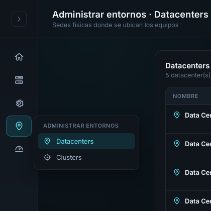

**Topbar.** Títulos de cada ruta:

| Ruta | Título | Subtítulo |
|---|---|---|
| `/administrar-entornos/datacenters` | Administrar entornos · Datacenters | Sedes físicas donde se ubican los equipos |
| `/administrar-entornos/clusters` | Administrar entornos · Clusters | Agrupaciones lógicas de equipos por datacenter y ambiente |

---

## 3. Estándares de diseño

No se crean estilos nuevos para lo que ya existe. Se reutiliza:

| Elemento | Clases o componentes existentes |
|---|---|
| Contenedor de página | `admin-equipos admin-equipos--wide` |
| Panel y tabla | `panel admin-mant-tabla`, `admin-mant-tabla__head`, `admin-mant-tabla__table`, `admin-mant-tabla__empty` |
| Buscador | `equipo-combobox__input-wrap admin-mant-tabla__search` con `IconSearch` |
| Modales | `ciclo-vida-modal__overlay`, `ciclo-vida-modal`, barra superior `ciclo-vida-modal__bar--accent` (registrar/editar) o `--red` (eliminar) |
| Botones del modal | `ciclo-vida-modal__cancel`, `ciclo-vida-modal__confirm--accent`, `ciclo-vida-modal__confirm--red` |

Lo nuevo está solo en `AdministrarEntornos.css` y usa exclusivamente variables del tema (`index.css`), por eso funciona igual en modo oscuro y claro:

| Elemento | Color |
|---|---|
| Botón "Nuevo …" | `--accent-soft` de fondo, `--accent-strong` de texto, borde de acento al 45 % |
| Lápiz (editar) | Mismo celeste que "Nuevo …" |
| Tacho (eliminar) | `--status-critical-bg` de fondo, `--status-critical` de ícono y borde (mismo rojo que "Dar de baja") |
| Etiqueta Producción | `--status-critical` sobre `--status-critical-bg` (rojo) |
| Etiqueta QA | `--status-warning` sobre `--status-warning-bg` (amarillo) |
| Etiqueta Desarrollo | `--status-good` sobre `--status-good-bg` (verde) |

Íconos nuevos en `components/icons.jsx`, con el mismo trazo que los demás: `IconPencil` e `IconTrash`. Los botones de ícono miden 32 × 32 px y tienen `title` y `aria-label` ("Editar …", "Eliminar …").

---

## 4. Pantalla Clusters

| Modo oscuro | Modo claro |
|---|---|
| 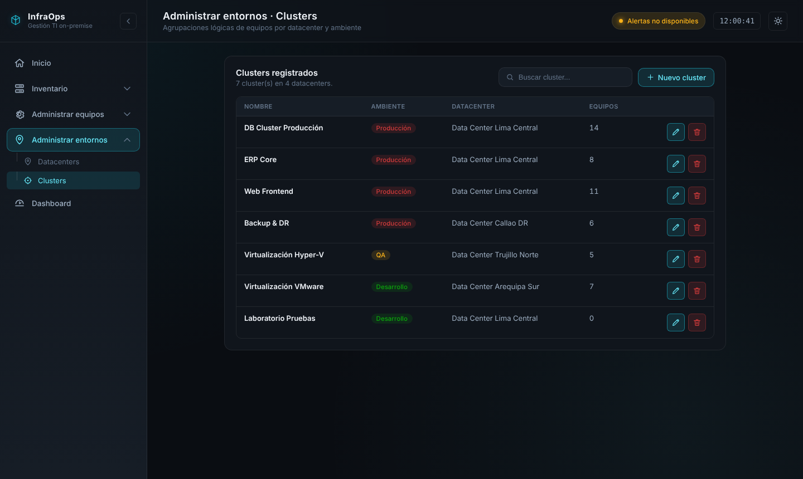 | 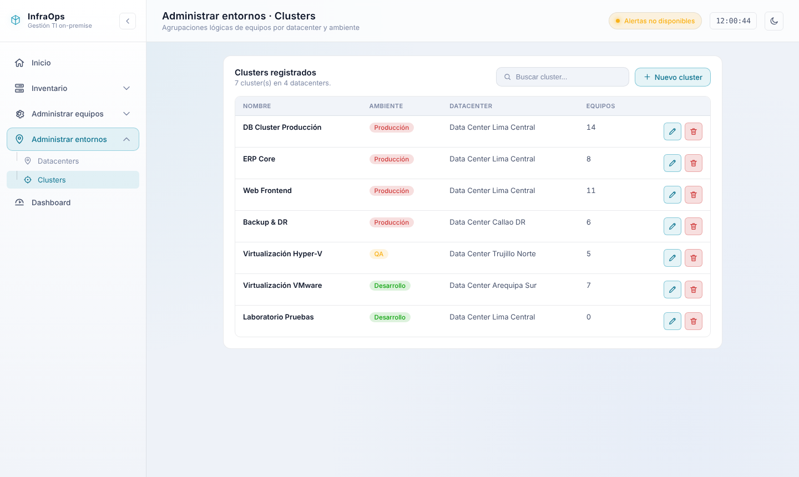 |

**Encabezado del panel:** "Clusters registrados" y debajo "N cluster(s) en M datacenters" (M = cantidad de datacenters distintos entre los clusters). A la derecha, el buscador ("Buscar cluster...") y el botón "+ Nuevo cluster".

**Tabla:**

| Columna | Contenido |
|---|---|
| Nombre | Nombre del cluster, en negrita |
| Ambiente | Etiqueta de color (Producción, QA o Desarrollo) |
| Datacenter | Nombre del datacenter |
| Equipos | Cantidad de activos asignados al cluster |
| (acciones) | Lápiz y tacho, alineados a la derecha |

El buscador filtra por nombre sin distinguir mayúsculas. Sin resultados: "Sin coincidencias."; sin datos: "No hay clusters registrados.".

### Nuevo cluster

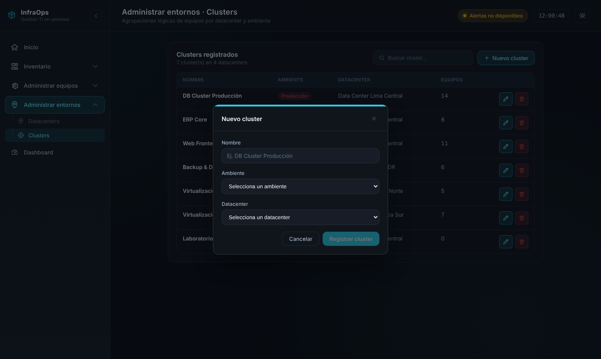

- Campos: Nombre (texto), Ambiente (select: Producción, QA, Desarrollo), Datacenter (select con los datacenters registrados).
- Los tres son obligatorios. "Registrar cluster" queda deshabilitado hasta que estén completos.
- El nombre no puede repetirse (el backend responde 409).

### Editar cluster

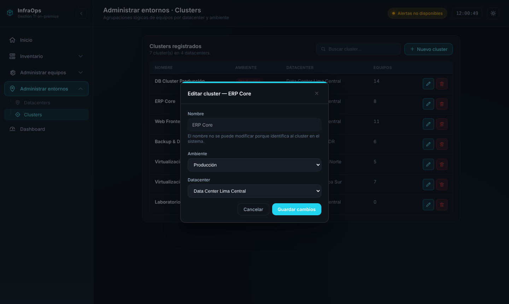

- Título: "Editar cluster — {nombre}". Los campos vienen llenos.
- El nombre se muestra deshabilitado con el texto "El nombre no se puede modificar porque identifica al cluster en el sistema.", porque es la clave primaria.
- Se pueden cambiar el ambiente y el datacenter. Botón: "Guardar cambios".

---

## 5. Pantalla Datacenters

| Modo oscuro | Modo claro |
|---|---|
| 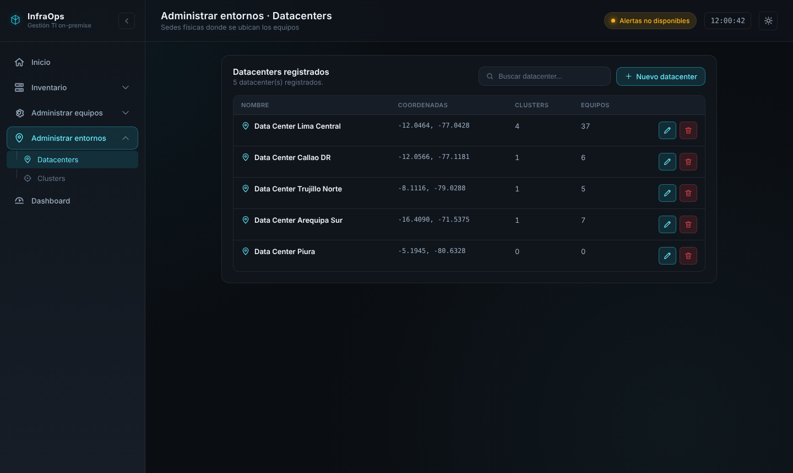 | 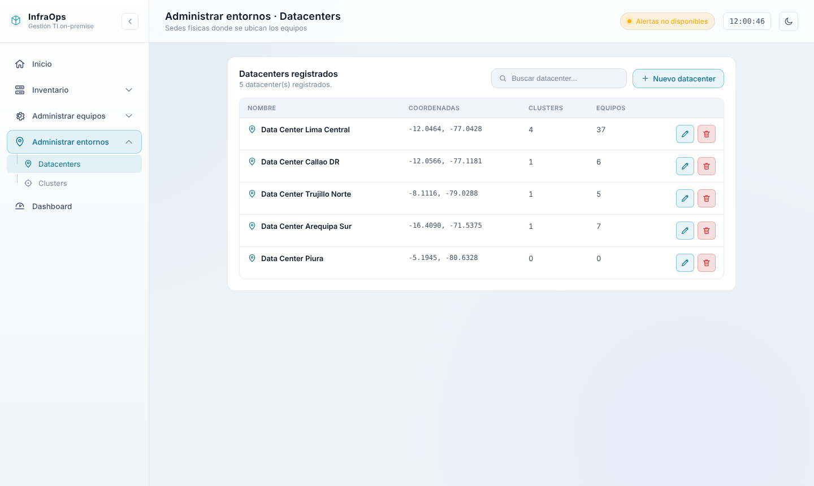 |

**Encabezado del panel:** "Datacenters registrados" y "N datacenter(s) registrados.". Buscador ("Buscar datacenter...") y botón "+ Nuevo datacenter".

**Tabla:**

| Columna | Contenido |
|---|---|
| Nombre | Ícono de ubicación en celeste y nombre en negrita |
| Coordenadas | "latitud, longitud" en fuente monoespaciada; "—" si no tiene |
| Clusters | Cantidad de clusters del datacenter |
| Equipos | Cantidad de activos ubicados en el datacenter |
| (acciones) | Lápiz y tacho |

### Nuevo datacenter

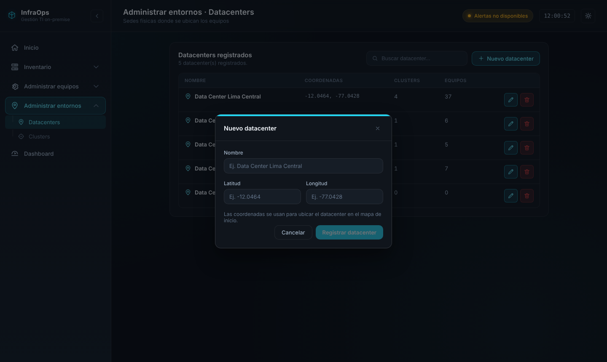

- Campos: Nombre (obligatorio), Latitud y Longitud (opcionales, en dos columnas).
- Texto de ayuda: "Las coordenadas se usan para ubicar el datacenter en el mapa de inicio."
- Validación: latitud entre -90 y 90, longitud entre -180 y 180. Si el valor no es válido se muestra el error debajo del campo en rojo y el botón queda deshabilitado:

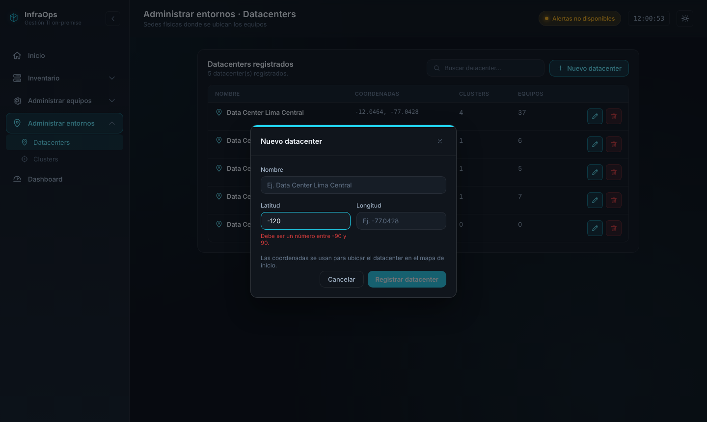

### Editar datacenter

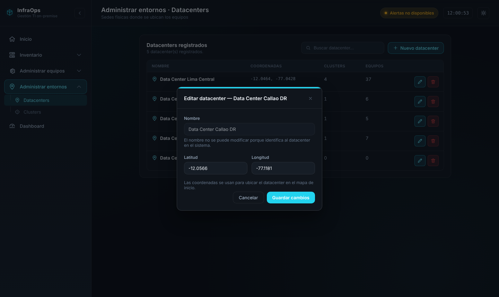

- Título: "Editar datacenter — {nombre}". El nombre queda deshabilitado (es la clave primaria), con el texto "El nombre no se puede modificar porque identifica al datacenter en el sistema.".
- Se pueden cambiar latitud y longitud, con la misma validación.

---

## 6. Reglas de eliminación

Las reglas se aplican en el front (para avisar antes) **y** en el backend (para que nunca se pueda saltar desde la API). Nunca se elimina en cascada.

| Entidad | Se puede eliminar si… | Si no se cumple |
|---|---|---|
| Cluster | No tiene activos asignados (`activo.cluster`) | Modal bloqueado, backend responde 409 |
| Datacenter | No tiene clusters (`clusters.datacenter`) **y** no tiene activos (`activo.ubicacion`) | Modal bloqueado, backend responde 409 |

**Eliminación permitida.** Barra roja, pregunta "¿Seguro que deseas eliminar el cluster/datacenter {nombre}? Esta acción no se puede deshacer." y botones "Cancelar" y "Eliminar cluster/datacenter" (rojo).

| Cluster sin equipos | Datacenter sin clusters ni equipos |
|---|---|
| 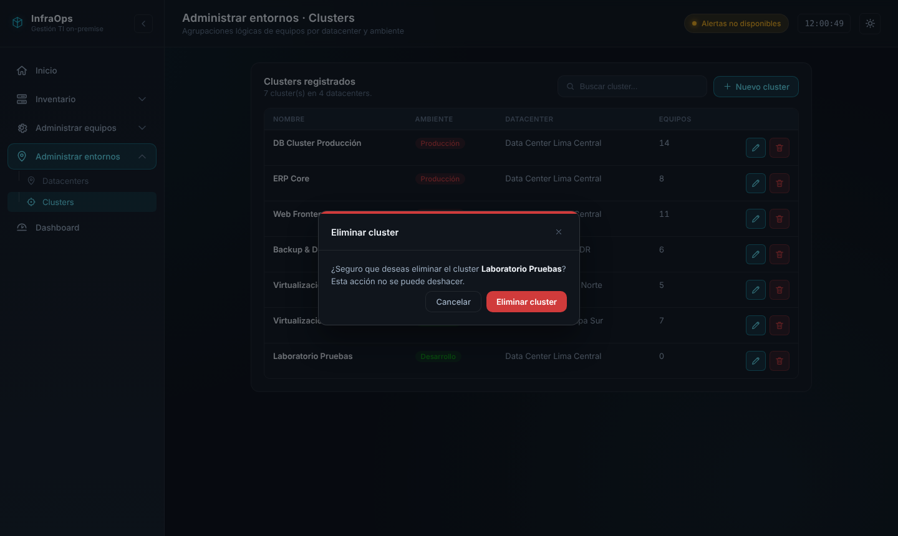 | 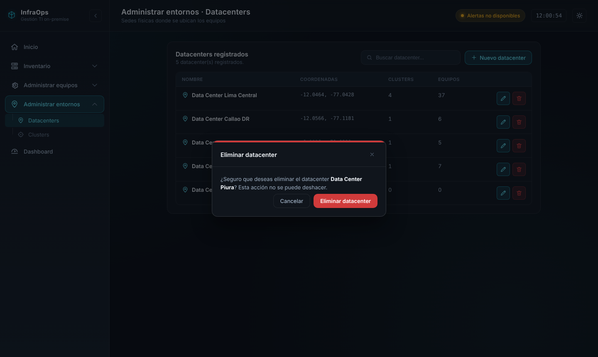 |

**Eliminación bloqueada.** Barra roja, mensaje con el motivo y solo el botón "Entendido":

- Cluster: "No se puede eliminar {nombre} porque tiene N equipo(s) asignado(s). Reasigna esos equipos a otro cluster antes de eliminarlo."
- Datacenter: "No se puede eliminar {nombre} porque tiene N cluster(s) y M equipo(s) asociados. Reasígnalos antes de eliminarlo."

| Cluster con equipos | Datacenter con clusters y equipos |
|---|---|
| 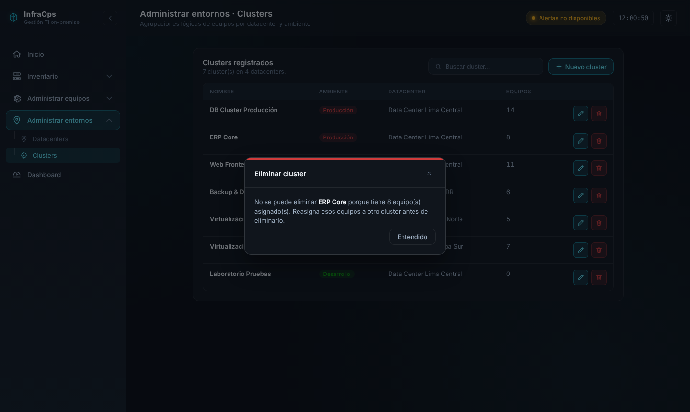 | 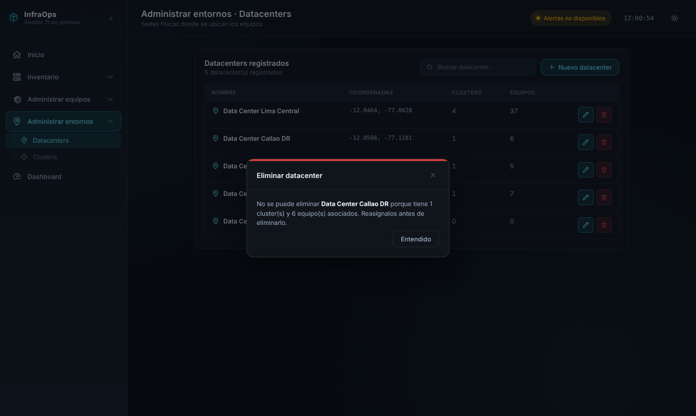 |

---

## 7. Contrato de la API

| Método y ruta | Estado actual | Cuerpo | Respuestas |
|---|---|---|---|
| `GET /api/clusters` | Existe; **agregar** `activos` | — | 200: `[{ nombre, ambiente, datacenter, activos }]` |
| `POST /api/clusters` | Existe | `{ nombre, ambiente, datacenter }` | 201; 400 datos inválidos; 404 datacenter inexistente; 409 nombre repetido |
| `PUT /api/clusters/{nombre}` | **Nuevo** | `{ ambiente, datacenter }` | 200; 400; 404 cluster o datacenter inexistente |
| `DELETE /api/clusters/{nombre}` | **Nuevo** | — | 204; 404; 409 si tiene activos |
| `GET /api/datacenters` | Existe; **agregar** `clusters` y `equipos` | — | 200: `[{ nombre, latitud, longitud, clusters, equipos }]` |
| `POST /api/datacenters` | **Nuevo** | `{ nombre, latitud, longitud }` | 201; 400 (nombre vacío o coordenadas fuera de rango); 409 nombre repetido |
| `PUT /api/datacenters/{nombre}` | **Nuevo** | `{ latitud, longitud }` | 200; 400; 404 |
| `DELETE /api/datacenters/{nombre}` | **Nuevo** | — | 204; 404; 409 si tiene clusters o activos |

- El ambiente viaja como `PRODUCCION`, `QA` o `DESARROLLO`.
- Latitud y longitud se guardan como texto (la columna es VARCHAR), pero se validan como número en el rango indicado.
- El nombre va en la URL; usar `encodeURIComponent` en el front porque puede tener espacios y "&".
- Los mensajes de error deben venir en español y listos para mostrarse en el modal.

---

## 8. Casos de verificación

**Clusters**
1. Registrar un cluster con los tres campos → aparece en la tabla.
2. Registrar un cluster con un nombre que ya existe → mensaje de error en el modal, el modal sigue abierto.
3. Editar ambiente y datacenter de un cluster → la tabla se actualiza y la etiqueta cambia de color.
4. Eliminar un cluster sin equipos → desaparece de la tabla.
5. Intentar eliminar un cluster con equipos → modal bloqueado; llamar a `DELETE` directo devuelve 409 y el cluster sigue existiendo.

**Datacenters**
6. Registrar un datacenter con coordenadas válidas → aparece en la tabla y en el select del modal de cluster.
7. Escribir latitud -120 → error debajo del campo y botón deshabilitado; el backend también responde 400.
8. Editar las coordenadas de un datacenter → la tabla se actualiza.
9. Eliminar un datacenter sin clusters ni equipos → desaparece de la tabla.
10. Intentar eliminar un datacenter con clusters o equipos → modal bloqueado; `DELETE` directo devuelve 409.

**Generales**
11. Todo se ve igual que las capturas en modo oscuro y claro.
12. Con el sidebar plegado, el menú flotante muestra "Administrar entornos" con sus dos opciones.
13. `npm run build` y `npm run lint` sin errores en el front; pruebas del backend en verde.

---

## 9. Requisitos relacionados

El RF-43 cubre registrar clusters y el RF-44 asignar un cluster al activo. Las acciones de editar y eliminar clusters, y de registrar, editar y eliminar datacenters, todavía no tienen requisito propio en la matriz. Si se mantienen, conviene agregar requisitos como:

- El sistema deberá permitir editar el ambiente y el datacenter de un cluster registrado.
- El sistema deberá permitir eliminar un cluster solo cuando no tenga activos asignados.
- El sistema deberá permitir registrar y editar datacenters con su nombre y sus coordenadas.
- El sistema deberá permitir eliminar un datacenter solo cuando no tenga clusters ni activos asociados.
