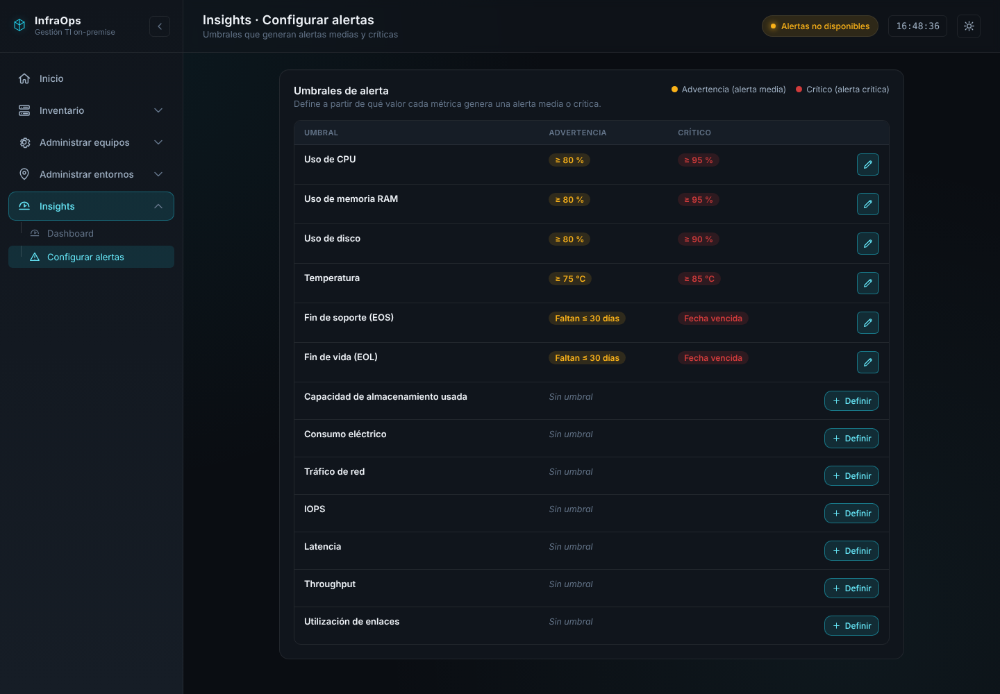
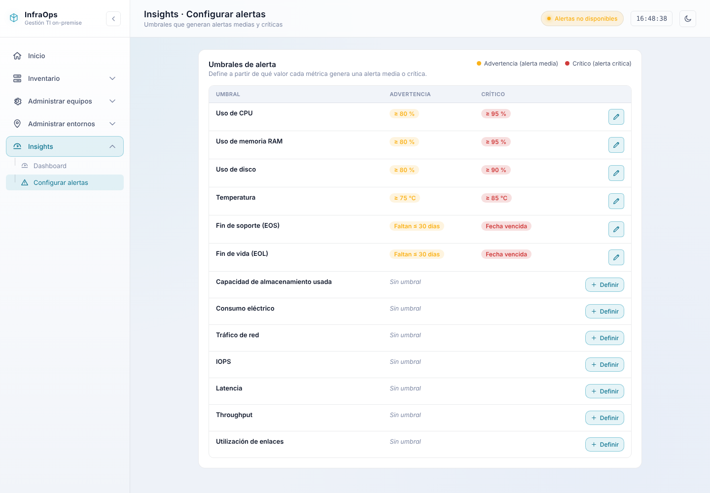
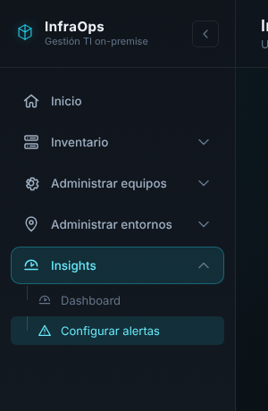
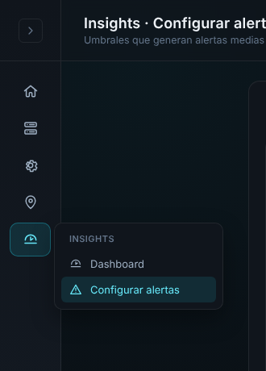
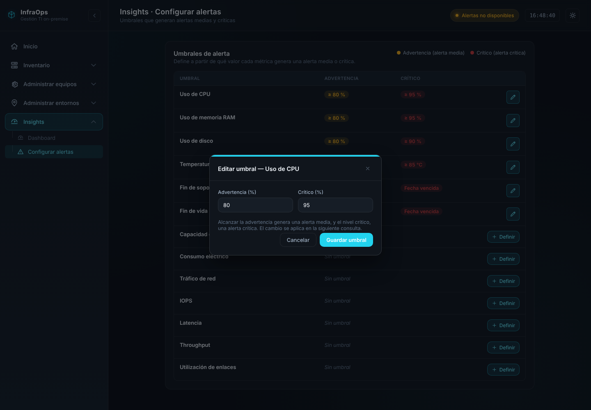
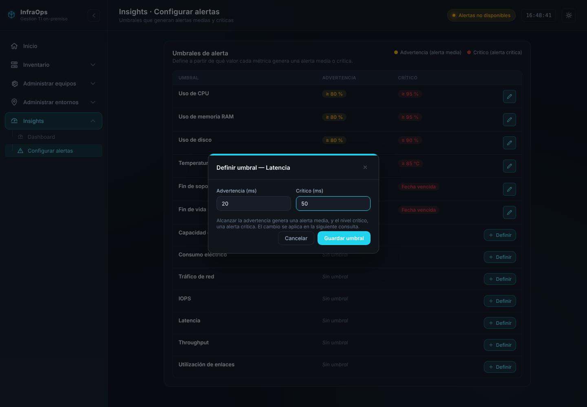
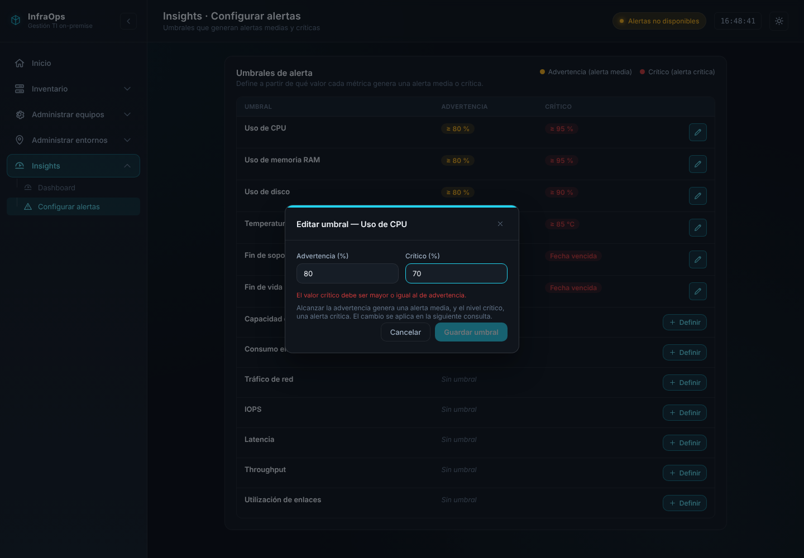
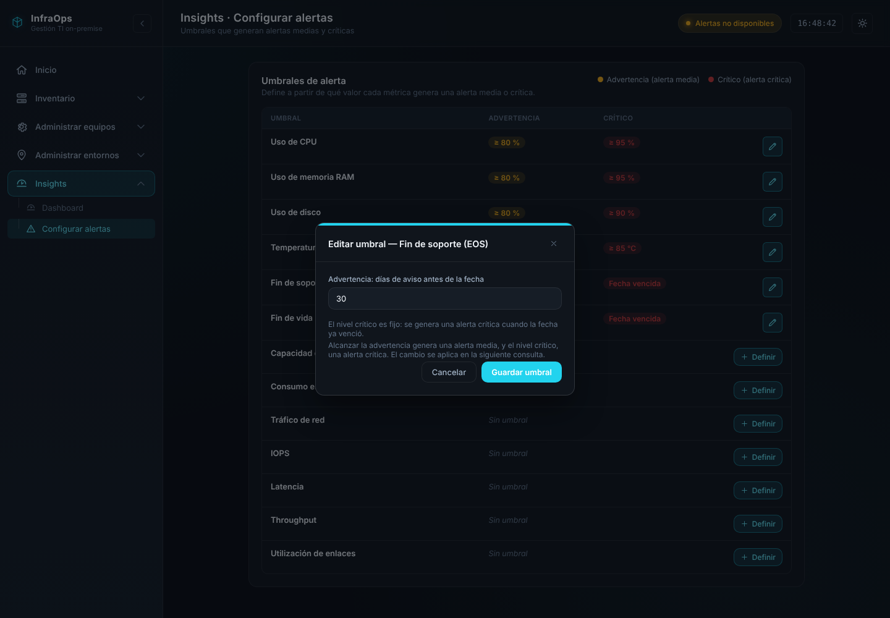

# Especificación: Configurar alertas (umbrales)

Pantalla del objetivo 3 para configurar los umbrales que generan alertas medias y críticas (HU-47 y HU-49). El resultado debe quedar igual a las capturas de `img/`.

| Archivo | Para qué sirve |
|---|---|
| `README.md` | Esta especificación y el prompt para Claude Code |
| `codigo/ConfigurarAlertas.jsx` | Página aprobada, con datos de ejemplo |
| `codigo/ConfigurarAlertas.css` | Estilos propios de la página |
| `img/` | Capturas finales |

**Requisito previo:** la sección "Administrar entornos" ya debe estar implementada, porque esta página reutiliza `IconPencil` y las clases de `AdministrarEntornos.css` (`entornos-btn`, `entornos-icon-btn`, `entornos-grid-2`, `entornos-error`, `entornos-ayuda`).

---

## 1. Prompt para Claude Code

Copiar esta carpeta en el repo del front como `docs/spec_configurar_alertas/` y pegar:

```text
Voy a implementar la pantalla "Configurar alertas". La especificación,
con capturas y reglas, está en docs/spec_configurar_alertas/README.md.
Léela entera antes de empezar. El resultado visual tiene que quedar
EXACTAMENTE igual a las capturas de docs/spec_configurar_alertas/img/.

PASO 1 - Front: agregar la página aprobada
- Copia docs/spec_configurar_alertas/codigo/ConfigurarAlertas.jsx y
  ConfigurarAlertas.css a src/pages/configurar-alertas/.
- En src/App.jsx importa la página y agrega la ruta
  /configurar-alertas.
- En src/components/Topbar.jsx agrega la entrada "/configurar-alertas"
  con título "Insights · Configurar alertas" y subtítulo
  "Umbrales que generan alertas medias y críticas". Cambia el título de
  "/dashboard" a "Insights · Dashboard" (el subtítulo no cambia).
- En src/components/Sidebar.jsx reemplaza el NavLink suelto de
  "Dashboard" por un nuevo SidebarGroup "Insights" (ícono
  IconDashboard), ubicado debajo de "Administrar entornos", con dos
  opciones en este orden: "Dashboard" (/dashboard, IconDashboard) y
  "Configurar alertas" (/configurar-alertas, IconAlert). El grupo se
  marca como activo en /dashboard y en /configurar-alertas. Usa el mismo
  patrón de los otros grupos (arreglo insightsLinks).
NO cambies estilos, textos, colores, clases ni el orden de las filas o
columnas: solo reemplaza los datos de ejemplo (paso 3).

PASO 2 - Backend (repo Backend-SI-INFRA-TI, rama DEV)
Implementa la sección 6 del README:
- Crea la tabla umbral con el script de la sección 5 y su entidad,
  repositorio, servicio, DTOs y controlador /api/umbrales, siguiendo el
  estilo de ClusterController/ClusterService.
- GET devuelve el catálogo completo de la sección 4 (13 filas),
  incluso las que no tienen umbral (valores en null).
- PUT /api/umbrales/{nombre} crea o actualiza el umbral (upsert).
- NO implementes DELETE: un umbral definido se edita, pero no se quita.
- Valida las reglas de la sección 3 y responde 400 con el mensaje en
  español si no se cumplen; 404 si el nombre no está en el catálogo.
- Agrega pruebas de servicio con los casos de la sección 7.

PASO 3 - Front: conectar con el backend
- En src/api/client.js agrega listarUmbrales() y
  guardarUmbral(nombre, datos), usando apiJson como las demás funciones
  y encodeURIComponent para el nombre.
- Reemplaza la constante UMBRALES por la respuesta de listarUmbrales(),
  cargada con useEffect. Mantén el orden de la sección 4.
- "Guardar umbral" llama a guardarUmbral, muestra "Guardando…"
  mientras espera, cierra el modal y recarga la tabla. Si la API
  responde 400, muestra el mensaje dentro del modal con la clase
  ciclo-vida-modal__error y deja el modal abierto.

PASO 4 - Verificación
Compara con las capturas de img/ en modo oscuro y claro, prueba los
casos de la sección 7 y corre npm run build, npm run lint y las pruebas
del backend. Avísame si algo no quedó idéntico y por qué.
```

---

## 2. Pantalla

| Modo oscuro | Modo claro |
|---|---|
|  |  |

- **Sidebar:** nuevo grupo **"Insights"** (ícono `IconDashboard`) debajo de "Administrar entornos", que reemplaza al enlace suelto de "Dashboard". Tiene dos opciones: "Dashboard" y "Configurar alertas" (`IconAlert`). Con el sidebar plegado se muestra en el menú flotante igual que los demás grupos.

| Sidebar expandido | Sidebar plegado |
|---|---|
|  |  |

- **Topbar:** "Insights · Configurar alertas" / "Umbrales que generan alertas medias y críticas". El Dashboard pasa a titularse "Insights · Dashboard".
- **Panel:** título "Umbrales de alerta" y texto "Define a partir de qué valor cada métrica genera una alerta media o crítica.". A la derecha, la leyenda: punto amarillo "Advertencia (alerta media)" y punto rojo "Crítico (alerta crítica)".
- **Tabla:** columnas Umbral, Advertencia, Crítico y acción. No hay columna de rango ni de "aplica a".

| Estado de la fila | Advertencia | Crítico | Acción |
|---|---|---|---|
| Métrica con umbral | Etiqueta amarilla "≥ 80 %" | Etiqueta roja "≥ 95 %" | Lápiz celeste |
| EOS o EOL | Etiqueta amarilla "Faltan ≤ 30 días" | Etiqueta roja "Fecha vencida" | Lápiz celeste |
| Sin umbral | Texto gris en cursiva "Sin umbral" (ocupa las dos columnas) | | Botón "+ Definir" |

No existe la acción de quitar un umbral.

---

## 3. Modales y reglas

### Editar o definir umbral de una métrica

| Editar | Definir |
|---|---|
|  |  |

- Título: "Editar umbral — {nombre}" o "Definir umbral — {nombre}".
- Dos campos en dos columnas: "Advertencia ({unidad})" y "Crítico ({unidad})".
- Texto de ayuda: "Alcanzar la advertencia genera una alerta media, y el nivel crítico, una alerta crítica. El cambio se aplica en la siguiente consulta."
- Botones "Cancelar" y "Guardar umbral". "Guardar umbral" queda deshabilitado mientras haya un error o un campo vacío.

Reglas (front y backend):

| Regla | Mensaje |
|---|---|
| Ambos valores son números positivos | "Los valores deben ser números positivos." |
| En métricas en %, ningún valor supera 100 (temperatura: 120 °C) | "Los valores no pueden superar 100 %." |
| Crítico mayor o igual a advertencia | "El valor crítico debe ser mayor o igual al de advertencia." |



### Editar umbral de fin de soporte (EOS) o fin de vida (EOL)



- Un solo campo: "Advertencia: días de aviso antes de la fecha".
- Texto: "El nivel crítico es fijo: se genera una alerta crítica cuando la fecha ya venció." El crítico no se edita y siempre vale 0.
- Regla: entero entre 1 y 365. Mensaje: "Ingresa un número entero de días entre 1 y 365."

---

## 4. Catálogo de umbrales (orden de la tabla)

Primero los que tienen umbral por defecto y después los que no. El `nombre` debe coincidir con el que el ETL guarda en `metrica_historica.nombre_metrica`.

| nombre | Etiqueta | Tipo | Unidad | Advertencia por defecto | Crítico por defecto |
|---|---|---|---|---|---|
| `cpu_uso_ghz` | Uso de CPU | métrica | % | 80 | 95 |
| `ram_uso_gb` | Uso de memoria RAM | métrica | % | 80 | 95 |
| `disco_uso_gb` | Uso de disco | métrica | % | 80 | 90 |
| `equipo_temperatura_c` | Temperatura | métrica | °C | 75 | 85 |
| `dias_para_eos` | Fin de soporte (EOS) | fecha | días | 30 | 0 (fijo) |
| `dias_para_eol` | Fin de vida (EOL) | fecha | días | 30 | 0 (fijo) |
| `almacenamiento_uso_tb` | Capacidad de almacenamiento usada | métrica | % | — | — |
| `equipo_consumo_w` | Consumo eléctrico | métrica | W | — | — |
| `red_trafico_mbps` | Tráfico de red | métrica | Mbps | — | — |
| `almacenamiento_iops` | IOPS | métrica | IOPS | — | — |
| `almacenamiento_latencia_ms` | Latencia | métrica | ms | — | — |
| `almacenamiento_throughput_mbps` | Throughput | métrica | Mbps | — | — |
| `red_utilizacion_pct` | Utilización de enlaces | métrica | % | — | — |

El catálogo (etiqueta, tipo, unidad y valor máximo) vive en el backend como constante; la tabla `umbral` solo guarda las filas que tienen valores.

---

## 5. Base de datos

```sql
CREATE TABLE umbral (
    id                 INTEGER GENERATED ALWAYS AS IDENTITY PRIMARY KEY,
    nombre             VARCHAR NOT NULL UNIQUE,
    unidad             VARCHAR NOT NULL,
    valor_advertencia  NUMERIC NOT NULL,
    valor_critico      NUMERIC NOT NULL
);

INSERT INTO umbral (nombre, unidad, valor_advertencia, valor_critico) VALUES
('cpu_uso_ghz',            '%',    80, 95),
('ram_uso_gb',             '%',    80, 95),
('disco_uso_gb',           '%',    80, 90),
('equipo_temperatura_c',   '°C',   75, 85),
('dias_para_eos',          'días', 30,  0),
('dias_para_eol',          'días', 30,  0);
```

Es una tabla de parametrización sin claves foráneas.

---

## 6. Contrato de la API

| Método y ruta | Cuerpo | Respuestas |
|---|---|---|
| `GET /api/umbrales` | — | 200: `[{ nombre, etiqueta, tipo, unidad, maximo, valorAdvertencia, valorCritico }]` en el orden de la sección 4; sin umbral, los valores vienen en `null` |
| `PUT /api/umbrales/{nombre}` | Métrica: `{ valorAdvertencia, valorCritico }`. Fecha: `{ valorAdvertencia }` | 200 con la fila guardada; 400 si no cumple las reglas; 404 si el nombre no está en el catálogo |

- `PUT` crea la fila si no existe ("Definir") o la actualiza ("Editar").
- No hay `DELETE`.
- En los umbrales de tipo fecha, el backend ignora cualquier `valorCritico` recibido y guarda 0.

---

## 7. Casos de verificación

1. La tabla muestra las 13 filas en el orden de la sección 4, con 6 umbrales definidos y 7 "Sin umbral".
2. Editar CPU a 85 y 97 → la tabla muestra "≥ 85 %" y "≥ 97 %".
3. Editar CPU con crítico 70 y advertencia 80 → mensaje de error y botón deshabilitado; un `PUT` directo responde 400.
4. Escribir 120 en una métrica en % → "Los valores no pueden superar 100 %."
5. Definir latencia en 20 y 50 ms → la fila pasa a mostrar "≥ 20 ms" y "≥ 50 ms" con lápiz.
6. Editar EOS a 60 días → la fila muestra "Faltan ≤ 60 días"; el crítico sigue en "Fecha vencida".
7. Escribir 0 o 400 días en EOS → mensaje de error; un `PUT` directo responde 400.
8. `PUT /api/umbrales/no_existe` → 404.
9. Todo se ve igual que las capturas en modo oscuro y claro.

---

## 8. Requisitos que cubre

| Requisito | Dónde se cumple |
|---|---|
| Configuración de umbrales de cualquier métrica | Botones "Editar" y "+ Definir" |
| Validación crítico ≥ advertencia | Modal y `PUT` |
| Umbrales por defecto (80/95, 80/95, 80/90, 75/85) | Script de la sección 5 |
| Aplicación en la siguiente consulta | El backend calcula las alertas leyendo `umbral` en cada consulta |
| Métricas sin umbral sin código de color | Filas "Sin umbral" |
| Configuración y valor por defecto de los días de aviso de EOS y EOL | Filas `dias_para_eos` y `dias_para_eol` |

La lista de equipos próximos a fin de soporte o vencidos (HU-49) no está en esta pantalla: se mostrará en la página de Alertas.
