# Especificación: Métricas del equipo (servidores)

Primera entrega de la pantalla de métricas: **servidores rackeables y blade**. Cubre HU-34 a HU-39, HU-50, HU-52, HU-54 y la parte de exportación de gráficos de la HU-56. Storage, switch y chasis se harán después sobre la misma página, agregando su configuración.

| Archivo | Para qué sirve |
|---|---|
| `README.md` | Esta especificación y el prompt para Claude Code |
| `codigo/MetricasActivo.jsx` | Página aprobada, con datos de ejemplo en la constante `EJEMPLO` |
| `codigo/LineChart.jsx` | Gráfico de líneas en SVG (sin librerías nuevas) |
| `codigo/MetricasActivo.css` | Estilos de la página y del gráfico |
| `codigo/MetricasActivoLink.jsx` | Botón "Ver métricas" para la ficha de detalle |
| `img/` | Capturas finales |

---

## 1. Prompt para Claude Code

Copiar esta carpeta en el repo del front como `docs/spec_metricas_servidor/` y pegar:

```text
Voy a implementar la pantalla "Métricas del equipo" para servidores
(rackeables y blade). La especificación, con capturas y reglas, está en
docs/spec_metricas_servidor/README.md. Léela entera antes de empezar.
El resultado visual tiene que quedar EXACTAMENTE igual a las capturas de
docs/spec_metricas_servidor/img/.

PASO 1 - Front: agregar la pantalla aprobada
- Copia codigo/MetricasActivo.jsx, codigo/LineChart.jsx y
  codigo/MetricasActivo.css a src/pages/metricas/.
- Copia codigo/MetricasActivoLink.jsx a src/pages/detail/.
- En ServerRackDetail.jsx y ServerBladeDetail.jsx agrega
  <MetricasActivoLink activoId={id} /> en el encabezado de "Datos
  generales", ANTES de <HistorialActivoLink /> (sección 2). No lo
  agregues todavía en storage, switch ni chasis.
- En src/App.jsx agrega la ruta /activos/:id/metricas.
- En src/components/Topbar.jsx, dentro de getMeta, agrega el caso
  /^\/activos\/\d+\/metricas$/ con título "Métricas del equipo" y
  subtítulo "Valor actual y evolución en el tiempo", igual que el caso
  del historial.
NO cambies estilos, textos, colores, clases ni el orden de los
elementos. No instales librerías de gráficos: LineChart.jsx es SVG puro.

PASO 2 - Backend (repo Backend-SI-INFRA-TI, rama DEV)
Implementa el endpoint de la sección 6:
- GET /api/activos/{id}/metricas con los parámetros de periodo.
- Agrupa y promedia en la consulta SQL con date_trunc según la tabla de
  agrupación (sección 5). No traigas todas las lecturas a memoria.
- Convierte CPU, RAM y disco a porcentaje con TotalesComponentes
  (sumarCpuGhz, sumarRamGb, sumarCapacidadDiscos), excluyendo los
  componentes en estado Baja.
- Suma el tráfico de todas las interfaces del servidor por intervalo,
  con entrada y salida por separado.
- Incluye en cada métrica su umbral, leído de la tabla umbral (null si
  no tiene).
- Responde 404 si el activo no existe y 400 si el periodo es inválido.
- Agrega pruebas de servicio para la agrupación, la conversión a
  porcentaje y los periodos.

PASO 3 - Front: conectar con el backend
- En src/api/client.js agrega obtenerMetricasActivo(id, periodo) que
  arme la URL con periodo=24h|7d|30d|1y o con desde/hasta.
- Reemplaza la constante EJEMPLO por la respuesta del endpoint, cargada
  con useEffect y recargada al cambiar el periodo o al pulsar "Aplicar"
  en el rango personalizado.
- El tipo del encabezado sale de activo.tipo: RACKEABLE = "Servidor
  rackeable", BLADE = "Servidor blade".
- "Comparar con otro servidor": la lista sale de listarServidores(),
  filtrada al mismo tipo (RACKEABLE o BLADE) y sin el equipo actual.
- Quita el bloque de maqueta que lee ?tipo=blade de la URL: el tipo real
  viene en datos.activo.tipo. Para cada servidor
  elegido llama a obtenerMetricasActivo con el mismo periodo y toma la
  métrica seleccionada. Máximo 3 servidores.
- Exportación (sección 4): implementa PDF, PNG y CSV sin librerías
  nuevas, con los nombres de archivo indicados.
- Estados: muestra "Cargando…" mientras carga, un mensaje de error si
  falla, y "Sin mediciones en este periodo." si no hay datos.

PASO 4 - Verificación
Compara con las capturas de img/ en modo oscuro y claro, prueba los
casos de la sección 7 y corre npm run build, npm run lint y las pruebas
del backend. Avísame si algo no quedó idéntico y por qué.
```

---

## 2. Botón en la ficha de detalle

| Modo oscuro | Modo claro |
|---|---|
| 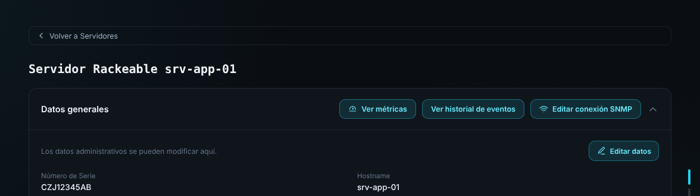 | 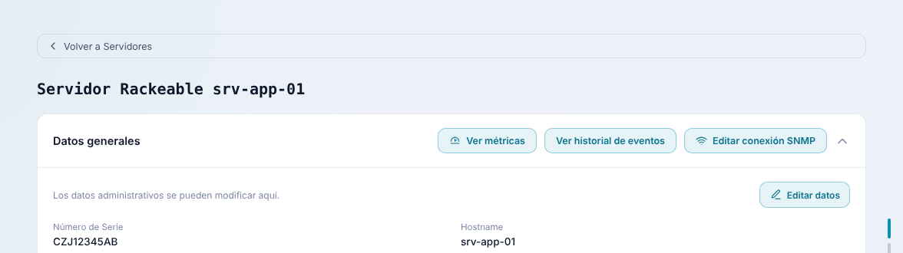 |

- En el encabezado de "Datos generales", primero de la fila: **Ver métricas** (ícono de dashboard), después "Ver historial de eventos" y "Editar conexión SNMP".
- Mismo estilo que los botones existentes (`detail-general-actions__btn`).
- Lleva a `/activos/{id}/metricas?volver={ruta de la ficha}`, igual que el historial.

---

## 3. Pantalla

| Modo oscuro | Modo claro |
|---|---|
|  |  |

De arriba abajo:

1. **Volver a la ficha** (usa el parámetro `volver`).
2. **Título** "Métricas · {hostname}" y subtítulo "{tipo} · Última medición: {fecha}".
3. **Barra de periodo:** 24 horas, 7 días, 30 días, 1 año y Personalizado (por defecto, 24 horas). A la derecha, el texto "Agrupado por {hora | día | semana} · promedio de cada intervalo" y el botón "Exportar PDF".
   - Con "Personalizado" aparecen los campos Desde y Hasta y el botón "Aplicar":

   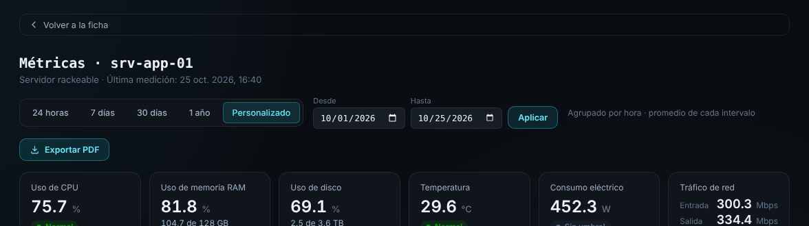

4. **Tarjetas de valor actual**, una por métrica en este orden: Uso de CPU, Uso de memoria RAM, Uso de disco, Temperatura, Consumo eléctrico, Tráfico de red.
   - Valor de la última medición, con su unidad.
   - Estado con punto y texto, nunca solo color: **Normal** (verde), **Advertencia** (amarillo), **Crítico** (rojo) o **Sin umbral** (gris), según la tabla `umbral`.
   - RAM y disco muestran además la cantidad usada sobre el total: "104,7 de 128 GB" y "2,5 de 3,6 TB".
   - Tráfico de red muestra dos filas, Entrada y Salida. Su estado se calcula con el mayor de los dos valores.
5. **Crecimiento del uso de recursos** (ancho completo): métricas en %, eje de 0 a 100 % y etiqueta al final de cada línea. La leyenda funciona como selector: cada métrica (CPU, RAM, Disco) tiene una casilla para mostrarla u ocultarla, con al menos una siempre marcada. Por defecto aparecen las tres.

   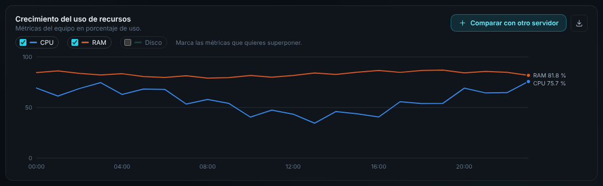
6. **Un gráfico por métrica** en dos columnas, en el mismo orden de las tarjetas:
   - Métricas con umbral: línea de crítico (roja) y de advertencia (amarilla), con su texto a la derecha del área del gráfico.
   - Una sola serie: línea con área suave debajo y sin leyenda (el título la nombra).
   - Tráfico de red: dos líneas (Entrada y Salida) con leyenda y sin área.

   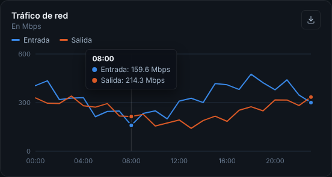

**Todos los gráficos** muestran al pasar el mouse una línea vertical y un tooltip con la hora y el valor de cada serie. Usan los colores `--series-1` a `--series-4` del tema, en ese orden fijo, y un solo eje Y.

### Comparación con otros servidores (HU-52)

| Elegir servidor | Comparación |
|---|---|
| 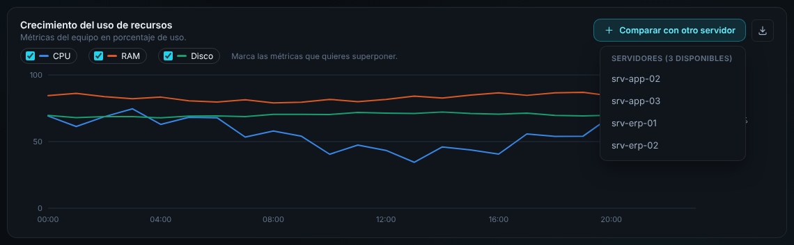 | 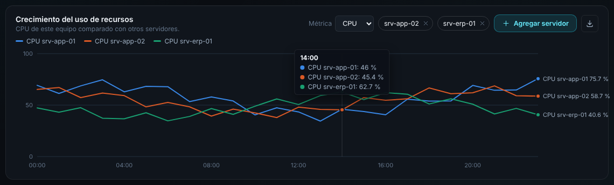 |

- **Comparar con otro servidor** abre una lista de servidores del mismo tipo, con la cantidad que todavía se puede agregar.
- Al elegir uno, el gráfico cambia a **una sola métrica** de varios equipos: aparece el selector "Métrica" (CPU, RAM o Disco), los chips de los servidores elegidos (con × para quitarlos) y el botón cambia a "Agregar servidor".
- Máximo 3 servidores además del actual (4 líneas en total). Al llegar al máximo, el botón desaparece.
- Al quitar todos los chips, el gráfico vuelve a mostrar CPU, RAM y disco del equipo.
- El texto bajo el título cambia a "{Métrica} de este equipo comparado con otros servidores."

### Servidor blade

Es la misma página y el mismo endpoint; no hay una pantalla aparte. Solo cambian:

- El subtítulo: "Servidor blade" en lugar de "Servidor rackeable" (sale de `activo.tipo`).
- La lista de "Comparar con otro servidor": solo muestra blades, con el título "Servidores blade (N disponibles)". En un rackeable dice "Servidores rackeables".
- Si el chasis es el que reporta la temperatura o el consumo y el blade no tiene lecturas propias, sus tarjetas muestran "Sin mediciones en este periodo." y el gráfico queda vacío, sin romper la página.

| Botón en la ficha del blade | Lista de comparación |
|---|---|
| 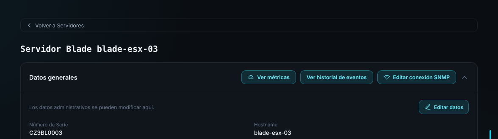 | 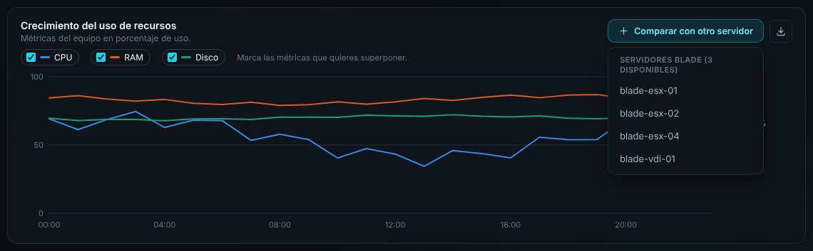 |

| Modo oscuro | Modo claro |
|---|---|
| 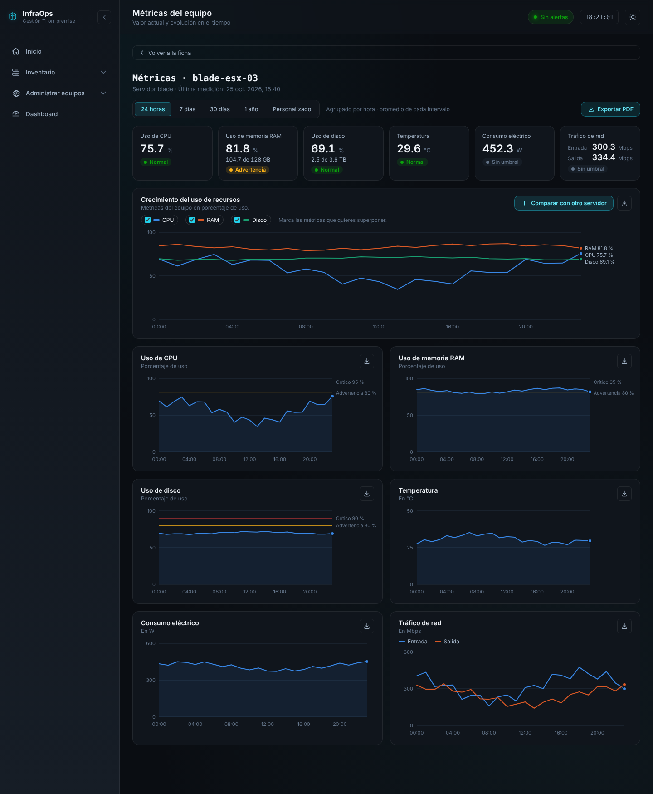 | 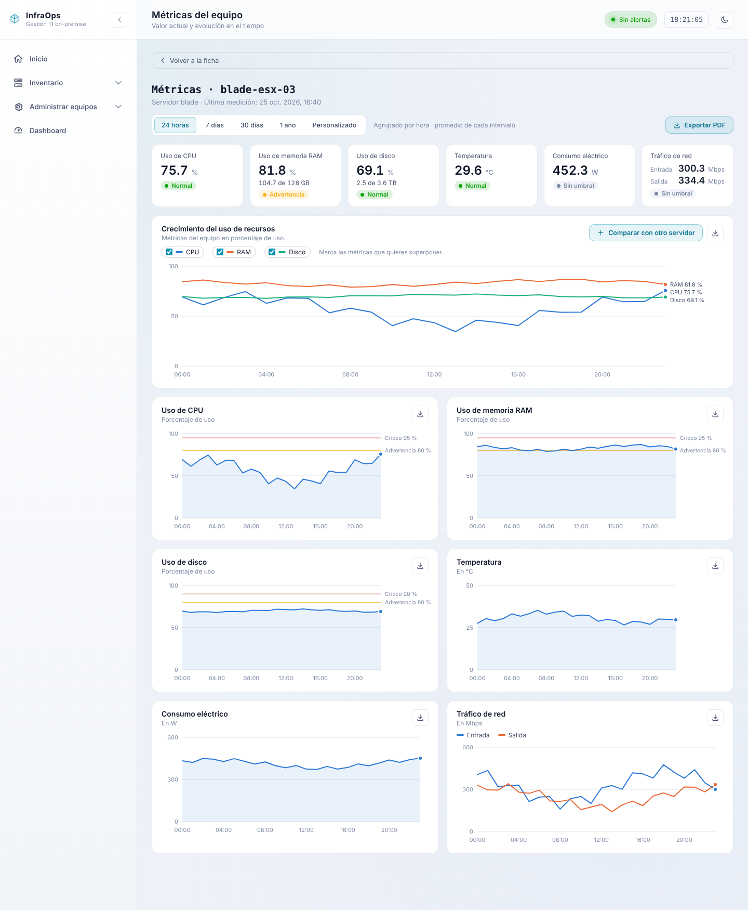 |

---

## 4. Exportación (HU-56)

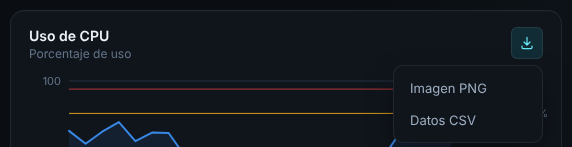

| Botón | Formato | Cómo generarlo (sin librerías nuevas) |
|---|---|---|
| "Exportar PDF" de la barra | PDF de toda la vista | `window.print()` con una hoja `@media print` que oculte el sidebar, el topbar y los botones, y que muestre el periodo consultado arriba |
| Ícono de descarga de cada gráfico → "Imagen PNG" | PNG del gráfico | Serializar el `<svg>`, dibujarlo en un `<canvas>` con el fondo del panel y, encima, una franja de texto con el nombre del gráfico, el hostname y el periodo consultado; descargar con `toDataURL` |
| Ícono de descarga de cada gráfico → "Datos CSV" | CSV de las series | Columnas `fecha` y una por serie, con una primera línea `# Periodo: {desde} a {hasta}` |

Nombre de los archivos: `{metrica}_{hostname}_{AAAA-MM-DD_HH-mm}.{png|csv}` y `metricas_{hostname}_{AAAA-MM-DD_HH-mm}.pdf`, con la fecha y hora de exportación. Por ejemplo, `uso-de-cpu_srv-app-01_2026-10-25_17-12.png`.

---

## 5. Periodos y agrupación (HU-54)

| Periodo | Rango | Agrupación |
|---|---|---|
| 24 horas | últimas 24 horas | por hora |
| 7 días | últimos 7 días | por día |
| 30 días | últimos 30 días | por día |
| 1 año | últimos 12 meses | por semana |
| Personalizado | desde/hasta elegidos | hasta 2 días: por hora; hasta 90 días: por día; más: por semana |

Cada punto es el **promedio** de las lecturas de su intervalo. Validaciones del rango personalizado: las dos fechas son obligatorias, "Desde" no puede ser posterior a "Hasta" y ninguna puede ser futura. "Aplicar" queda deshabilitado mientras no se cumplan.

---

## 6. Contrato de la API

`GET /api/activos/{id}/metricas?periodo=24h|7d|30d|1y`
`GET /api/activos/{id}/metricas?desde=AAAA-MM-DD&hasta=AAAA-MM-DD`

```json
{
  "activo": { "id": 1, "hostname": "srv-app-01", "tipo": "RACKEABLE" },
  "ultimaMedicion": "2026-10-25T16:40:00",
  "desde": "2026-10-24T17:00:00",
  "hasta": "2026-10-25T16:40:00",
  "agrupacion": "hora",
  "etiquetas": ["2026-10-24T17:00:00", "2026-10-24T18:00:00"],
  "metricas": [
    {
      "nombre": "cpu_uso_ghz",
      "etiqueta": "Uso de CPU",
      "corto": "CPU",
      "unidad": "%",
      "maximo": 100,
      "umbral": { "advertencia": 80, "critico": 95 },
      "capacidad": null,
      "series": [ { "nombre": "CPU", "valores": [55.2, 61.8] } ]
    },
    {
      "nombre": "ram_uso_gb",
      "etiqueta": "Uso de memoria RAM",
      "corto": "RAM",
      "unidad": "%",
      "maximo": 100,
      "umbral": { "advertencia": 80, "critico": 95 },
      "capacidad": { "total": 128, "unidad": "GB" },
      "series": [ { "nombre": "RAM", "valores": [81.2, 81.8] } ]
    },
    {
      "nombre": "red_trafico_mbps",
      "etiqueta": "Tráfico de red",
      "unidad": "Mbps",
      "umbral": null,
      "series": [
        { "nombre": "Entrada", "valores": [320.1, 288.4] },
        { "nombre": "Salida", "valores": [240.6, 251.0] }
      ]
    }
  ]
}
```

- `capacidad` solo viene en RAM (`total` en GB) y disco (`total` en TB); en las demás métricas es `null`. El front calcula la cantidad usada como porcentaje × total ÷ 100.
- `etiquetas` y cada arreglo `valores` tienen la misma longitud. Si un intervalo no tiene lecturas, su valor es `null` y la línea se corta en ese tramo.
- El front formatea las etiquetas según la agrupación (hora: "14:00"; día: "25 oct"; semana: "Sem. 43").

| Métrica (orden) | `nombre` en `metrica_historica` | Unidad mostrada | Cálculo |
|---|---|---|---|
| Uso de CPU | `cpu_uso_ghz` | % | valor ÷ `sumarCpuGhz` (velocidad × núcleos) × 100 |
| Uso de memoria RAM | `ram_uso_gb` | % | valor ÷ `sumarRamGb` × 100 |
| Uso de disco | `disco_uso_gb` | % | valor ÷ `sumarCapacidadDiscos` × 100 |
| Temperatura | `equipo_temperatura_c` | °C | promedio directo |
| Consumo eléctrico | `equipo_consumo_w` | W | promedio directo |
| Tráfico de red | `red_trafico_entrada_mbps` y `red_trafico_salida_mbps` | Mbps | suma de las interfaces por instante, luego promedio por intervalo |

Si el ETL todavía guarda los nombres anteriores (`espacio_usado_disco_gb`, `temperatura`, `consumo_electrico_w`), el backend debe aceptar ambos mientras se completa el cambio de nombres.

---

## 7. Casos de verificación

1. En la ficha de un servidor rackeable y de uno blade aparece "Ver métricas" primero; "Volver a la ficha" regresa a esa misma ficha.
2. Con 24 horas se ven 24 puntos agrupados por hora y el texto "Agrupado por hora".
3. Con 7 y 30 días la agrupación pasa a "por día"; con 1 año, a "por semana".
4. Rango personalizado de 3 días → por día; con "Desde" posterior a "Hasta", "Aplicar" deshabilitado y el backend responde 400.
5. Un servidor con RAM al 81 % muestra la tarjeta en "Advertencia" y la línea cruzando la marca de 80 %.
6. Una métrica sin umbral muestra "Sin umbral" y su gráfico no tiene líneas de referencia.
7. El uso de CPU nunca supera 100 % (se divide entre velocidad × núcleos).
8. Comparar con dos servidores y cambiar la métrica a RAM → las tres líneas pasan a RAM; con 3 servidores agregados desaparece "Agregar servidor".
9. Exportar un gráfico a PNG y a CSV, y la vista a PDF, con los nombres de archivo indicados.
10. Servidor sin mediciones en el periodo → "Sin mediciones en este periodo.".
11. Todo se ve igual que las capturas en modo oscuro y claro.

---

## 8. Requisitos que cubre

| Requisito | Qué pide | Dónde se cumple |
|---|---|---|
| RF-48 | CPU en % de velocidad × núcleos | Tarjeta y gráfico de CPU; cálculo en el backend con `sumarCpuGhz` |
| RF-49 | RAM en GB y en % del total instalado | Tarjeta de RAM ("81,8 %" y "104,7 de 128 GB") |
| RF-50 | Disco en TB y en % de la capacidad total | Tarjeta de disco ("69,1 %" y "2,5 de 3,6 TB") |
| RF-51 | Disco como total por servidor | Un solo valor de disco por servidor |
| RF-52, RF-53 | Temperatura en °C y consumo en W | Tarjetas y gráficos |
| RF-54, RF-55 | Tráfico en Mbps, entrada y salida por separado | Tarjeta con dos filas y gráfico con dos líneas |
| RF-71, RF-74 | Colores por umbral; sin umbral sin color | Estado de las tarjetas, líneas de referencia y "Sin umbral" en gris |
| RF-90 | Botón en la ficha que abre las métricas | "Ver métricas" en rackeable y blade |
| RF-91 | Valor actual con unidad y fecha de la última medición | Tarjetas y subtítulo "Última medición" |
| RF-92 | Evolución de cada métrica en el periodo | Un gráfico por métrica |
| RF-93 | Solo las métricas del tipo de equipo | Configuración por tipo (servidor: 6 métricas) |
| RF-94 | Valor actual con el color de su umbral | Estado de cada tarjeta |
| RF-102 | Seleccionar métricas en % y superponerlas | Casillas de la leyenda del gráfico de crecimiento |
| RF-103 | Eje de 0 a 100 % y tiempo en el eje horizontal | Gráfico de crecimiento |
| RF-104 | Comparar una métrica con equipos del mismo tipo | Modo comparación (hasta 3 servidores) |
| RF-105 | Todas las series en el mismo periodo | Las comparaciones usan el periodo de la vista |
| RF-106 | Leyenda con el nombre de la métrica o del equipo | Leyenda y etiquetas finales |
| RF-116 a RF-122 | Periodos, rango personalizado, agrupación, promedio, periodo común y 24 h por defecto | Barra de periodo y endpoint (sección 5) |
| RF-128, RF-130 | Exportar cada gráfico en PNG y CSV | Menú de exportación de cada gráfico |
| RF-131 | La exportación respeta el periodo | PNG, CSV y PDF usan el periodo seleccionado |
| RF-132 | Nombre con el gráfico y la fecha de exportación | Nombres de archivo de la sección 4 |
| RF-133 | El archivo indica el periodo consultado | Franja de texto del PNG, primera línea del CSV y encabezado del PDF |

El RF-127 pide el PDF del resumen general y de las vistas consolidadas; el PDF de esta pantalla es un extra que usa el mismo mecanismo. El RF-56 (tráfico por puerto) corresponde al switch y queda para la siguiente entrega.
